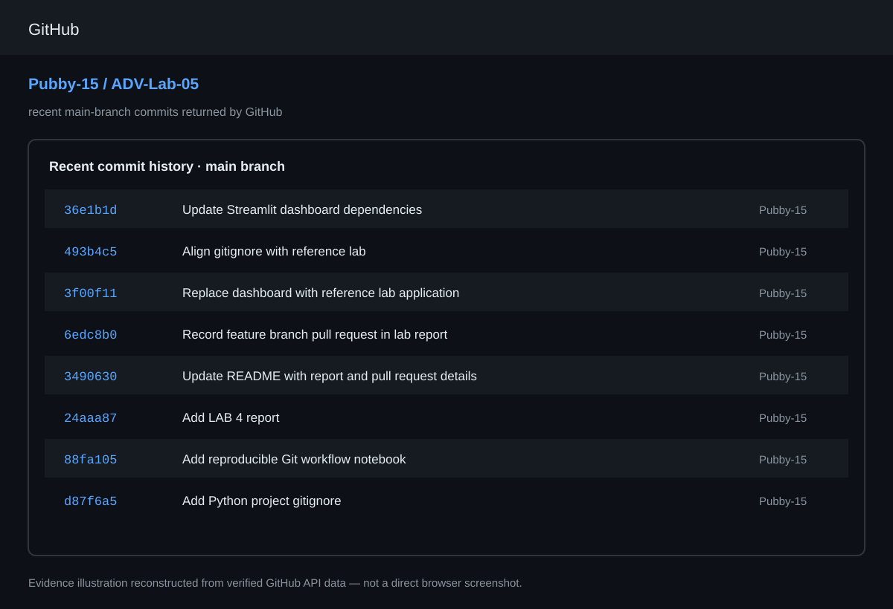
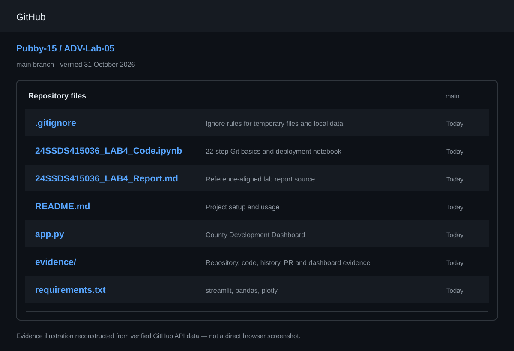
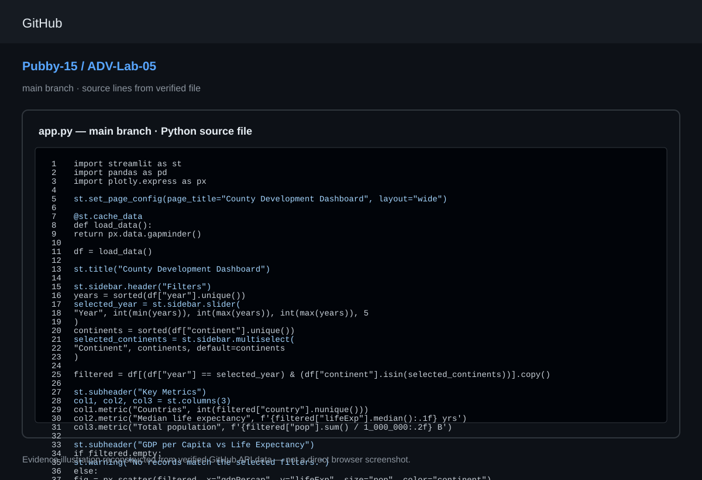
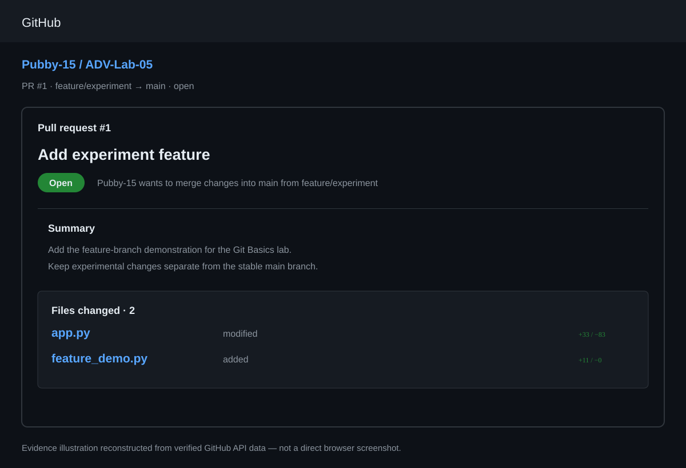
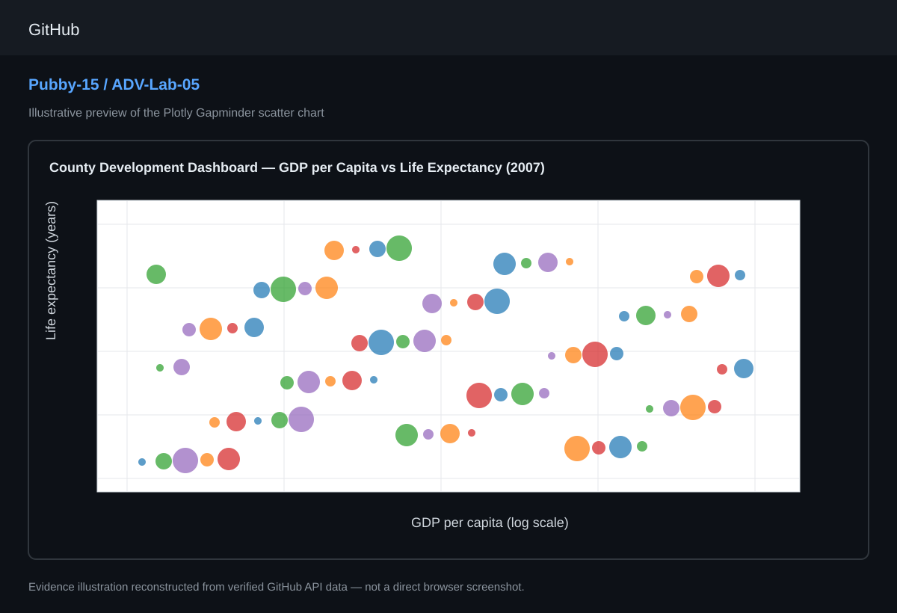

# LAB 4 — GIT BASICS FOR A PYTHON PROJECT

**Student:** Prabhas P Simha  
**USN:** 24SSDS415036  
**Programme:** Data Science and Analytics  
**University:** Ramaiah University of Applied Sciences, Bengaluru  
**Date:** 31 October 2026

## PROBLEM STATEMENT

Software projects need a reliable way to track changes and allow developers to work on the same code without overwriting each other's work. Git provides version control for this purpose. This lab follows a Python project from basic project files to a GitHub-hosted repository. A GitHub Personal Access Token (PAT) is used for HTTPS authentication when required. The project also prepares a Streamlit dashboard for deployment through GitHub and Streamlit Community Cloud.

## LEARNING OBJECTIVES

- Initialize and use a local Git repository, including the staging, commit, and log workflow.
- Create a `.gitignore` file to keep unnecessary and sensitive files out of version control.
- Understand GitHub Personal Access Token authentication for HTTPS pushes.
- Connect a local repository to a remote GitHub repository and push commits.
- Practice the everyday add, commit, and push cycle.
- Create a feature branch, commit changes on it, and use a pull request for review.
- Prepare a Streamlit dashboard and its dependencies for cloud deployment.

## WHY YOU NEED A PERSONAL ACCESS TOKEN

GitHub does not accept account passwords for Git operations over HTTPS. A Personal Access Token can be used in place of a password. It should be created in GitHub Developer Settings with the repository permissions needed for the task. The token must be treated as a secret and entered securely, not written directly into a notebook, Python file, README, or remote URL. The notebook uses a hidden prompt and a temporary Git askpass helper so that the token is not printed in notebook output.

# PROCEDURE

## TASK 1: SET UP YOUR ENVIRONMENT

### Step 1: Configuring Git Identity

**Description**  
Git identity is configured for the Colab session using a username and the email associated with the GitHub account. This information is attached to commits so that the author of each change can be identified.

**Code Used**

```python
subprocess.run(["git", "config", "--global", "user.name", "Prabhas P Simha"], check=True)
git_email = input("Enter the email associated with your GitHub account: ").strip()
subprocess.run(["git", "config", "--global", "user.email", git_email], check=True)
```

**Interpretation**  
The Git username and email are configured. New commits created in the session will use this identity. Enter the email associated with the GitHub account before running the cell.

### Step 2: Connecting to the Existing GitHub Repository

**Description**  
The existing public repository `Pubby-15/ADV-Lab-05` is cloned into the notebook environment. Cloning first preserves the remote history and avoids creating an unrelated local history.

**Code Used**

```python
GITHUB_USER = "Pubby-15"
REPO_NAME = "ADV-Lab-05"
REPO_URL = f"https://github.com/{GITHUB_USER}/{REPO_NAME}.git"

if not Path(".git").exists():
    subprocess.run(["git", "clone", REPO_URL, REPO_NAME], check=True)
    os.chdir(REPO_NAME)
```

**Interpretation**  
The repository is cloned and the working directory is changed to the project folder. Existing files and commits are retained.

## TASK 2: CREATE AND STRUCTURE THE PROJECT

### Step 1: Creating the Project Files

**Description**  
The project uses `app.py`, `requirements.txt`, and `README.md`. The notebook checks whether each file exists and creates a starter file only when missing, so existing project work is not overwritten.

**Code Used**

```python
if not Path("app.py").exists():
    Path("app.py").write_text("print('hello from my project')\\n")
if not Path("requirements.txt").exists():
    Path("requirements.txt").write_text("pandas\\nmatplotlib\\n")
if not Path("README.md").exists():
    Path("README.md").write_text("# My Project\\n\\nA small project for the Git Basics lab.\\n")
```

**Interpretation**  
The three main project files are checked or created. `app.py` contains the Python application, `requirements.txt` lists dependencies, and `README.md` provides project documentation.

## TASK 3: ADD A .gitignore FILE

**Description**  
A `.gitignore` file prevents temporary files, cache folders, local data, and environment secrets from being included in version control.

**Code Used**

```python
gitignore_content = """.ipynb_checkpoints/
__pycache__/
*.pyc
.env
.venv/
venv/
data/
*.csv
*.xlsx
*.parquet
"""
Path(".gitignore").write_text(gitignore_content, encoding="utf-8")
```

**Interpretation**  
The ignore rules exclude Jupyter checkpoints, Python cache files, environment files, local virtual environments, data folders, and local data files.

## TASK 4: INITIALIZE, ADD AND COMMIT

### Step 1: Initializing the Local Repository

```bash
git init -q
git add .
git status
```

**Interpretation**  
`git init` initializes or reinitializes the local repository. `git add .` moves changed files into the staging area, and `git status` displays staged and unstaged changes.

### Step 2: Creating the Initial Commit and Viewing History

```bash
git commit -m "Initial commit: project skeleton"
git log --oneline
```

**Interpretation**  
The commit stores a snapshot of staged changes. `git log --oneline` displays the repository history in a compact format. The notebook skips an empty commit when no files are staged.



*Figure 1. Recent commit history reconstructed from verified repository commit data.*

## TASK 5: CREATE THE GITHUB REPOSITORY AND PUSH

**Description**  
The local project is connected to the existing public GitHub repository. The URL is set as the `origin` remote. The notebook requests a Personal Access Token through a hidden prompt and passes it to Git through a temporary askpass helper.

**GitHub Repository:** https://github.com/Pubby-15/ADV-Lab-05

**Code Used**

```python
remote_url = f"https://github.com/{GITHUB_USER}/{REPO_NAME}.git"
# Add or update the origin remote with the repository URL.
# Enter the Personal Access Token with getpass.getpass("GitHub PAT (hidden): ")
# The notebook uses a temporary GIT_ASKPASS script for authentication.
subprocess.run(["git", "branch", "-M", "main"], check=True)
git_push_secure("main")
```

**Interpretation**  
The local branch is named `main` and connected to GitHub through `origin`. The hidden token prompt is used if HTTPS authentication is needed. The repository is public and contains the dashboard source, notebook, report source, and supporting files.



*Figure 2. Main-branch repository contents. This evidence illustration was reconstructed from authenticated GitHub repository API data on 31 October 2026; it is not a direct browser screenshot.*

## TASK 6: PRACTICE THE EVERYDAY GIT WORKFLOW

**Description**  
The starter application file is updated with the Streamlit dashboard. The updated file is staged, committed, and pushed to the `main` branch.

**Code Used**

```bash
git add app.py
git commit -m "Update app.py"
git push origin main
git log --oneline
```

**Interpretation**  
This demonstrates the standard daily Git workflow: modify the required files, stage changes, save a commit, and push it to GitHub. Commit history provides a record of project versions.

### Streamlit Dashboard Code

The application uses Plotly's bundled Gapminder sample dataset. It provides a year slider, a continent selector, three key metrics, and a scatter plot comparing GDP per capita with life expectancy.

```python
import streamlit as st
import pandas as pd
import plotly.express as px

st.set_page_config(page_title="County Development Dashboard", layout="wide")

@st.cache_data
def load_data():
    return px.data.gapminder()

df = load_data()
st.title("County Development Dashboard")

st.sidebar.header("Filters")
years = sorted(df["year"].unique())
selected_year = st.sidebar.slider(
    "Year", int(min(years)), int(max(years)), int(max(years)), 5
)
continents = sorted(df["continent"].unique())
selected_continents = st.sidebar.multiselect(
    "Continent", continents, default=continents
)

filtered = df[(df["year"] == selected_year) & (df["continent"].isin(selected_continents))].copy()

st.subheader("Key Metrics")
col1, col2, col3 = st.columns(3)
col1.metric("Countries", int(filtered["country"].nunique()))
col2.metric("Median life expectancy",
            f'{filtered["lifeExp"].median():.1f} yrs' if not filtered.empty else "0.0 yrs")
col3.metric("Total population",
            f'{filtered["pop"].sum() / 1_000_000:.2f} B' if not filtered.empty else "0.00 B")

st.subheader("GDP per Capita vs Life Expectancy")
if filtered.empty:
    st.warning("No records match the selected filters.")
else:
    fig = px.scatter(
        filtered, x="gdpPercap", y="lifeExp", size="pop", color="continent",
        hover_name="country", log_x=True, size_max=55,
        title=f"Development Overview — {selected_year}",
        labels={"gdpPercap": "GDP per capita", "lifeExp": "Life expectancy", "pop": "Population"},
    )
    fig.update_layout(height=620)
    st.plotly_chart(fig, use_container_width=True)

st.caption("LAB 4 — Git Basics for a Python Project")
```



*Figure 3. Source view reconstructed from the verified main-branch `app.py` file.*

## TASK 7: CREATE A BRANCH AND PUSH IT

### Step 1: Viewing Existing Branches

```bash
git branch
```

**Interpretation**  
The command lists the local branches and highlights the active branch.

### Step 2: Creating or Switching to a Feature Branch

```bash
git checkout -b feature/experiment
```

When the remote feature branch already exists, the notebook fetches and switches to it rather than creating a duplicate branch.

**Interpretation**  
The `feature/experiment` branch keeps experimental changes separate from the stable `main` branch.

### Step 3: Making a Change on the Feature Branch

```python
with open("app.py", "r+", encoding="utf-8") as f:
    content = f.read()
    if "# Feature experiment branch update" not in content:
        f.write("\\n# Feature experiment branch update\\n")
```

### Step 4: Staging, Committing and Pushing

```bash
git status
git add app.py
git commit -m "Add experiment feature"
git push -u origin feature/experiment
```

**Interpretation**  
The changes are committed on the feature branch and pushed to GitHub. A pull request is used to propose review and merging into `main`.



*Figure 4. Pull Request #1 is open from `feature/experiment` into `main`. Its changes include the feature marker in `app.py` and the `feature_demo.py` example. The illustration is reconstructed from verified pull request API data, not a browser capture.*

## TASK 8: PREPARE THE STREAMLIT DASHBOARD FOR DEPLOYMENT

### Step 1: Switching Back to the Main Branch

```bash
git switch main
```

**Interpretation**  
The working environment is switched back from the feature branch to the stable `main` branch.

### Step 2: Checking Existing Dependencies

```bash
cat requirements.txt
```

### Step 3: Updating requirements.txt for Streamlit

```python
with open("requirements.txt", "w", encoding="utf-8") as f:
    f.write("streamlit\\npandas\\nplotly\\n")
```

### Step 4: Committing and Pushing Deployment Requirements

```bash
git add requirements.txt
git commit -m "Update requirements for Streamlit"
git push origin main
```

**Interpretation**  
The dependency file lists Streamlit, Pandas, and Plotly. These dependencies can be installed by the deployment platform when it builds the dashboard.

### Step 5: Deploying on Streamlit Community Cloud

1. Open https://share.streamlit.io/ and sign in with GitHub.
2. Select **Create app**.
3. Select repository `Pubby-15/ADV-Lab-05`.
4. Select the `main` branch.
5. Select `app.py` as the main application file.
6. Click **Deploy** and wait for dependency installation.
7. Copy the generated public URL after the app starts successfully.

**Interpretation**  
The GitHub repository is prepared for Streamlit Community Cloud. The application and dependency file are present, but a live deployment URL has not yet been generated or verified.

**GitHub Repository:** https://github.com/Pubby-15/ADV-Lab-05  
**Pull Request:** https://github.com/Pubby-15/ADV-Lab-05/pull/1  
**Streamlit App URL:** Deployment pending



*Figure 5. County Development Dashboard chart preview based on Plotly's bundled Gapminder sample data (2007 view).*

## GITHUB ACCOUNT AND REPOSITORY EVIDENCE

The profile screenshot included in the Word report is the actual screenshot supplied by the student. Repository file-list, source-file, commit-history, and pull-request illustrations are reconstructed from verified GitHub API responses checked on 31 October 2026. They are clearly identified as API-derived evidence and not direct browser captures.

## DATA INSIGHTS & FINDINGS

### Key Findings

- Git provides a structured way to track important versions of a software project.
- The staging area allows developers to select the changes included in each commit.
- Commit messages make project history easier to understand and maintain.
- A `.gitignore` file keeps temporary files, local datasets, and environment secrets out of version control.
- GitHub acts as a remote hosting and collaboration platform for Git repositories.
- Personal Access Tokens can provide secure authentication for HTTPS Git operations.
- Feature branches allow new functionality to be developed separately from the stable `main` branch.
- The Streamlit dashboard can be maintained with the source code and dependency list in the same repository.
- A clear `requirements.txt` makes the dashboard easier to reproduce and deploy.

### Overall Insight

This lab demonstrates that version control is an important part of software and data science development. Git maintains a history of changes, while GitHub provides remote storage and a place to review changes. Branch-based development makes experimentation safer, and keeping dependencies documented supports reproducibility.

## BUSINESS RECOMMENDATIONS / APPLICATIONS

1. **Use version control for all projects.** Start Git tracking from the beginning of software and data science projects.
2. **Create meaningful commits.** Save small changes with clear commit messages instead of grouping unrelated work together.
3. **Protect sensitive files.** Use `.gitignore` and never place passwords, API keys, or tokens in public repositories.
4. **Use feature branches.** Develop and test new features separately before merging them into the stable branch.
5. **Maintain proper documentation.** Include a README explaining the project purpose, setup, dependencies, and usage.
6. **Maintain deployment dependencies.** Update `requirements.txt` whenever the application uses additional libraries.
7. **Use GitHub for collaboration and portfolio development.** A well-maintained repository provides a central place for backup, version tracking, collaboration, and showcasing work.

## CONCLUSION

The objective of this lab was to understand Git version control for a Python project and connect the project to a remote GitHub repository. A project structure containing `app.py`, `requirements.txt`, and `README.md` was checked, and a `.gitignore` file was added to exclude unnecessary files.

The fundamental Git workflow of staging, committing, and viewing history was practiced. The local repository was connected to the public GitHub repository `Pubby-15/ADV-Lab-05`. The dashboard source was updated with Streamlit code using the Gapminder sample dataset, and its dependencies were recorded in `requirements.txt`.

A separate `feature/experiment` branch was used to demonstrate independent development. Pull Request #1 was opened against `main` and remains open for review. Finally, the project was prepared for Streamlit Community Cloud deployment. Deployment is still pending until a live application URL is created and tested.

Overall, this experiment demonstrates how Git and GitHub support project tracking, collaboration, feature development, and application deployment preparation.

